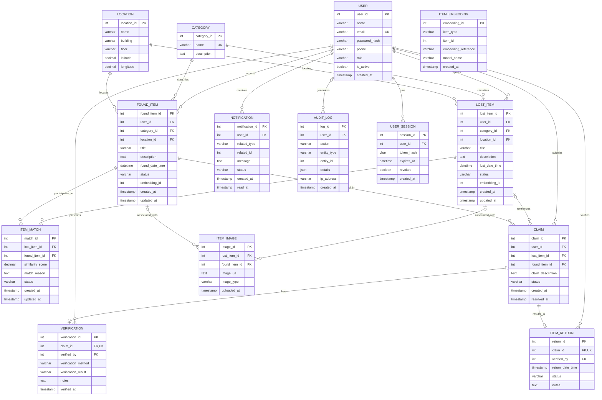

# Entity Relationship Diagram (ERD)

**Project:** Lost & Found Item Intelligence System  
**Database:** MySQL — `lost_found_intelligence`

The ER diagram represents the entities, attributes, primary keys (PK), foreign keys (FK), and relationships implemented in `database/schema.sql`.

## Relationship Notes

- One user can report multiple lost and found items.
- Each lost or found item belongs to one category and one location.
- A lost item and a found item can participate in multiple match records.
- A claim references a found item and can optionally reference a lost item.
- Each claim can have at most one verification record and one return record.
- An item image can reference a lost item, a found item, or both according to the current schema.
- `ITEM_EMBEDDING.item_id` is a general item reference, not a declared foreign key.
- `NOTIFICATION.related_id` and `AUDIT_LOG.entity_id` are not declared foreign keys in the current schema.

**Notation:** PK = Primary Key; FK = Foreign Key; UK = Unique Key.
