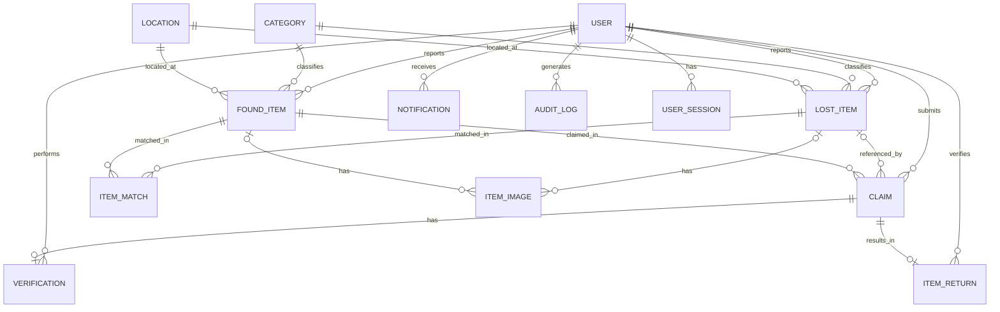

# Entity Relationship Diagram (ERD)

This diagram represents the main entities and foreign-key relationships in the Lost & Found Item Intelligence System.

## Entities

- **USER:** Stores user accounts, roles, and authentication details.
- **CATEGORY:** Classifies reported items.
- **LOCATION:** Stores campus locations.
- **LOST_ITEM / FOUND_ITEM:** Stores lost and found reports.
- **ITEM_MATCH:** Records potential matches and similarity scores.
- **CLAIM:** Tracks claims made against found items.
- **VERIFICATION:** Stores claim verification details.
- **ITEM_RETURN:** Records item return information.
- **ITEM_IMAGE:** Stores image references for reported items.
- **ITEM_EMBEDDING:** Stores references to item embedding data.
- **NOTIFICATION:** Stores user notifications.
- **AUDIT_LOG:** Records selected system actions.
- **USER_SESSION:** Stores hashed session tokens and expiry details.
